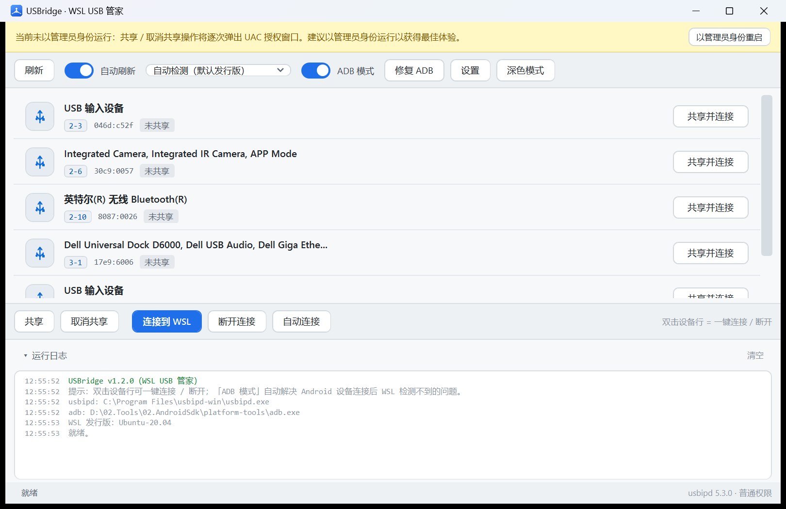
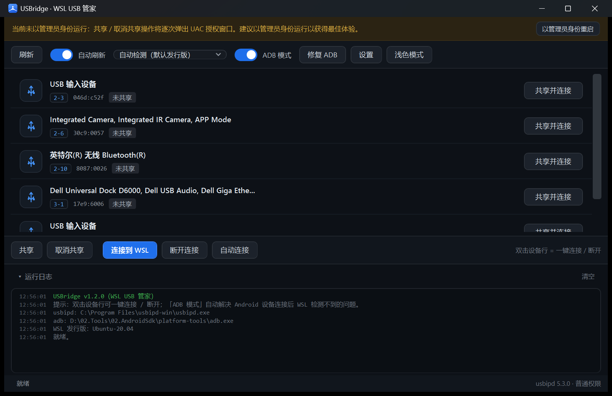

# USBridge (WSL USB 管家)

<div align="center">


**A Windows desktop tool that bridges USB devices into WSL with one click — built to fix the infamous "Android device disappears from ADB" problem.**

[](LICENSE)
[](#build--run)
[](#build--run)
[](../../releases)
[](../../actions/workflows/release.yml)

English | [中文](README.md)

</div>

A green single-file GUI for [usbipd-win](https://github.com/dorssel/usbipd-win) that hands USB
devices (including Android phones) to WSL with one click. Specially tuned for **Android ADB
debugging** — it fixes the classic issue where a device attached to WSL is invisible to
`adb devices` until you run `adb kill-server` on Windows.

> The UI itself is Chinese (with tooltips covering every action). This page documents everything in English;
> the [terminology table](#terminology) maps the Chinese UI labels to usbipd commands.

## UI Preview

| Light theme | Dark theme |
| --- | --- |
|  |  |

## Highlights

- **Green single file** — zero runtime dependencies on Windows 10 1903+ / Windows 11
- **ADB Mode** automates the full recovery flow: Windows `adb kill-server` → WSL `modprobe vhci_hcd` → attach → restart adb inside WSL as root
- **Disconnect** runs `adb start-server` on Windows so the device is usable again immediately
- Portable bundle **ships a green adb and the official usbipd-win MSI** — missing usbipd? One-click silent install from the UI

## Terminology

The UI intentionally avoids the literal translations (bind / attach) and uses more intuitive
"share / connect" wording. Mapping to the official commands:

| UI label (中文) | usbipd command | Meaning |
| --- | --- | --- |
| 共享 (Share) | `bind` | Authorize the device for WSL. Done once, persists across reboots, requires admin |
| 取消共享 (Unshare) | `unbind` | Revoke the authorization (requires admin) |
| 连接到 WSL (Connect to WSL) | `attach --wsl` | Hand the device to WSL; temporarily unavailable on Windows |
| 断开连接 (Disconnect) | `detach` | Return the device to Windows and automatically start the Windows adb server |
| 自动连接 (Auto-connect) | `attach --wsl --auto-attach` | Background daemon: device attaches itself every time it is plugged in |

## Features

- **Device list**: live BUSID / VID:PID / description / state (not shared, shared, connected to WSL, auto-connecting)
- **One-click actions**: the per-row button morphs with the state — *Share & Connect → Connect to WSL → Disconnect*; **double-click a row** does the smart thing
- **ADB Mode** (the killer feature): full automatic recovery when connecting Android devices (see below)
- **Fix ADB button**: manually run the Windows + WSL adb repair routine at any time
- **Auto-recovery on disconnect**: runs Windows `adb start-server` after detaching
- **Auto-connect**: background daemon based on `usbipd --auto-attach`, survives app restarts
- **Auto refresh**: 3-second polling plus instant WM_DEVICECHANGE events on plug/unplug
- **WSL distro picker** for multi-distro setups (auto-detect by default)
- **Elevation friendly**: share/unshare trigger a single UAC prompt when not elevated; one-click admin restart in the banner
- **Dark / Light themes**: GitHub Dark / Light, live switching, persisted, title bar follows
- **System tray**: left-click to restore, right-click quick menu, optional minimize/close-to-tray
- **Single instance**: launching again just brings the existing window to the front
- **Color-coded activity log**: every step and error, collapsible

## What ADB Mode actually does

**Symptom**: after attaching a phone to WSL, `lsusb` inside WSL shows the device but `adb devices`
stays empty — until you run `adb kill-server` on Windows.

**Cause**: the Windows adb server (kept alive by Android Studio and friends) holds the phone's USB
interface, so once usbip hands the device over to WSL, the WSL side cannot talk to it.

**Automatic recovery** (when ADB Mode is on and the device looks like Android):

```
1. Windows:  adb kill-server                  ← release the device from the Windows adb server
2. WSL:      modprobe vhci_hcd                ← ensure the kernel module is loaded (skipped if built in)
3. usbipd:   attach --wsl --busid <X-X>       ← connect to WSL
4. WSL:      adb kill-server && adb start-server && adb devices
             (run as root to sidestep udev permission issues; device list is printed to the log)
```

A device is considered Android when its description contains `Android / ADB / MTP / HDB`, or its
VID:PID starts with `18d1:4ee*` (Google ADB interfaces). A settings toggle extends the flow to every device.

**On disconnect**: the app runs Windows `adb start-server` so the Windows adb stack rediscovers the device instantly.

## Download & Install

Grab `USBridge-x.y.z-portable.zip` from [**Releases**](../../releases), unzip, and run `USBridge.exe`:

- `USBridge.exe` — the app (green/portable, zero dependencies on Win10 1903+ / Win11)
- `tools\adb\` — bundled adb, **no Android SDK required**, used automatically with top priority
- `tools\usbipd\usbipd.msi` — unmodified official usbipd-win MSI; if usbipd is missing the UI shows a **one-click silent install** button

The only prerequisite on the target machine: WSL2 installed (`wsl --install`).
Inside WSL, `sudo apt install adb` (Ubuntu) is recommended.

The portable bundle is assembled by `pack.cmd` (downloads official platform-tools and the usbipd-win
MSI automatically); CI repeats the exact same process on every release.

## Build & Run

No .NET SDK or Visual Studio needed — the build script uses the C# compiler that ships with Windows:

```bat
build.cmd    rem produces dist\USBridge.exe
pack.cmd     rem produces pack\USBridge\ and dist\USBridge-portable.zip
```

Pushing a `v*` tag triggers GitHub Actions to build and publish a Release automatically (assets include a SHA256 checksum).

## Usage

| Action | Description |
| --- | --- |
| Refresh (F5) | Rescan USB devices |
| Auto refresh | Poll every 3 s; instant refresh on plug/unplug events |
| Distro dropdown | Pick the target WSL distro, auto-detect by default |
| ADB Mode | Auto-run the ADB repair flow when connecting Android devices (recommended) |
| Fix ADB | Manually run Windows `adb kill-server` + WSL adb restart |
| Share / Unshare | `usbipd bind / unbind` (requires admin; auto single-prompt UAC) |
| Connect to WSL / Disconnect | `usbipd attach --wsl / detach` (disconnect auto-runs `adb start-server`) |
| Auto-connect | Toggle the background daemon (`usbipd --auto-attach`) |
| Double-click a row | Smart action: not shared → share & connect; shared → connect; connected → disconnect |
| Light / Dark mode | One-click theme switch, applied live and remembered |
| Tray icon | Left-click to restore; right-click menu for refresh / fix ADB / theme / exit |
| Activity log | Output and errors for every step, collapsible |

## FAQ

**Q: `adb devices` inside WSL still shows nothing after connecting?**
Hit the **Fix ADB** button first. If the log says adb is missing in WSL, run `sudo apt install adb`.
Note that the tool restarts the WSL adb server **as root**, so no udev rules are needed.

**Q: The device "disappears" again while Android Studio is open?**
Android Studio respawns the Windows adb server and re-claims the device. Close it, or hit **Fix ADB** again.

**Q: How do I give the device back to Windows?**
Select the connected device and click **Disconnect** (or double-click the row). The **Share** flag stays
on — it is just a harmless authorization marker; only **Unshare** when you are sure you will never connect it again.

**Q: Why does Share prompt UAC?**
`usbipd bind/unbind` are system-level operations. Run the app as administrator (one click in the banner) to stop the prompts.

**Q: Kernel module error when connecting?**
Older WSL2 kernels may not have vhci_hcd built in. The tool runs `modprobe vhci_hcd` before connecting (toggleable in settings).

**Q: Can I run multiple windows?**
No — single instance by design: launching again restores the existing window. The auto-connect daemon bookkeeping
lives in a shared config, and two instances would kill each other's daemons. **Connecting multiple devices simultaneously is supported** (select each device and connect in one window).

**Q: Where did the tray icon go?**
Windows 11 hides new tray icons in the overflow flyout: click the **^** arrow near the clock, or enable
WSL USB Manager under Settings → Personalization → Taskbar → Other system tray icons.

**Q: Does auto-connect survive app exit?**
Yes — it is an independent usbipd background process. Stop it by selecting the device and clicking **Stop auto-connect**.

## Roadmap

See [docs/ROADMAP.md](docs/ROADMAP.md).

## Repository Layout

```
├── build.cmd              Build script (uses the C# compiler built into Windows)
├── pack.cmd               Portable-bundle script (build + fetch bundled components + zip)
├── tools-readme.txt       Source of the README.txt shipped in the portable bundle
├── app.manifest           DPI awareness / execution level manifest
├── assets/
│   ├── make-logo.ps1      Logo generator (procedural GDI+ drawing)
│   ├── logo.ico           Multi-size app icon (16 ~ 256px)
│   └── logo.png           Logo image for README
├── docs/
│   ├── images/            UI screenshots
│   └── ROADMAP.md         Roadmap
└── src/
    ├── App.cs             Entry point: single instance, global exceptions, app icon
    ├── Main.cs            Main-window controller: wiring, connect/disconnect/ADB flows, logging
    ├── MainWindow.xaml    Main UI (GitHub Dark / Light themes, runtime-loaded XAML)
    ├── SettingsDialog.xaml Settings window
    ├── Theme.cs           Dark/Light brush palettes (live DynamicResource switching)
    ├── Tray.cs            Tray icon (NotifyIcon wrapper + icon conversion)
    ├── Usbipd.cs          usbipd CLI wrapper + `usbipd list` output parser
    ├── ProcessRunner.cs   Process runner: UTF-8/UTF-16/GBK auto-decode, timeouts, UAC capture
    ├── Wsl.cs             wsl.exe wrapper (distro list, modprobe, WSL-side adb restart)
    ├── Adb.cs             adb.exe discovery and kill-server / start-server
    └── Settings.cs        INI key-value settings persistence
```

## License & Acknowledgements

- This project is released under the [MIT License](LICENSE)
- [usbipd-win](https://github.com/dorssel/usbipd-win) (GPL-3.0): the MSI bundled in the portable pack is the unmodified official build
- [Android platform-tools](https://developer.android.com/tools/releases/platform-tools) (Apache-2.0): official adb bundled in the portable pack
- Design inspired by [nickbeth/wsl-usb-manager](https://github.com/nickbeth/wsl-usb-manager)
