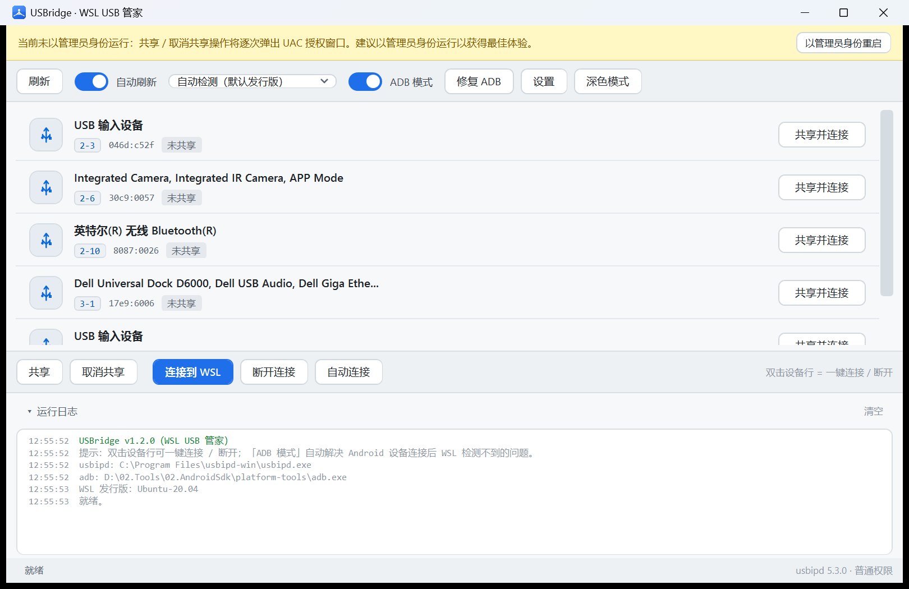
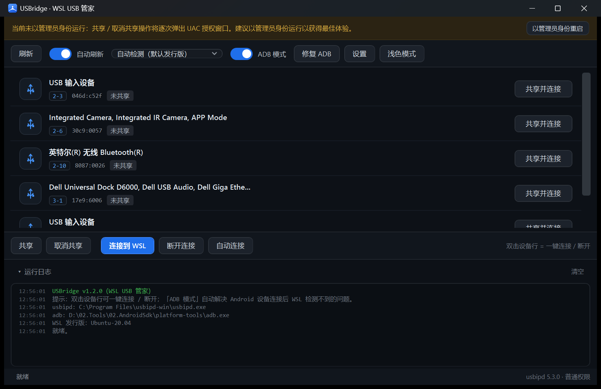

# USBridge · WSL USB 管家

<div align="center">


**把 USB 设备一键桥接进 WSL 的 Windows 桌面工具，专治 Android ADB 调试的"设备消失"问题。**

[](LICENSE)
[](README.md#%E6%9E%84%E5%BB%BA%E4%B8%8E%E8%BF%90%E8%A1%8C)
[](README.md#%E6%9E%84%E5%BB%BA%E4%B8%8E%E8%BF%90%E8%A1%8C)
[](../../releases)
[](../../actions/workflows/release.yml)

</div>

一个绿色单文件的图形界面工具，管理 [usbipd-win](https://github.com/dorssel/usbipd-win)，
把 USB 设备（含 Android 手机）一键桥接进 WSL。针对 **Android ADB 调试** 场景重点优化——
专治"设备连接到 WSL 后 `adb devices` 检测不到，必须在 Windows 上先 `adb kill-server`"的经典问题。

## 界面预览

| 浅色主题 | 深色主题 |
| --- | --- |
|  |  |

## 界面预览之外：为什么选它

- **绿色单文件**，Win10 1903+ / Win11 零运行时依赖
- **ADB 模式**自动完成 Windows `adb kill-server` → WSL `modprobe vhci_hcd` → 连接 → WSL 内 root 重启 adb 的全流程
- **断开连接**自动 `adb start-server`，设备交还 Windows 立即可用
- 便携版**内置绿色 adb 与 usbipd-win 官方 MSI**，缺 usbipd 一键静默安装

## 术语对照表

界面刻意避开了直译词（绑定/附加），改用更直觉的「共享/连接」。对照官方命令：

| 界面用语 | usbipd 命令 | 含义 |
| --- | --- | --- |
| 共享 | `bind` | 授权该设备允许连接到 WSL（一次即可，持久生效，需管理员） |
| 取消共享 | `unbind` | 撤销授权（需管理员） |
| 连接到 WSL | `attach --wsl` | 把设备交给 WSL 使用，Windows 暂时不可用 |
| 断开连接 | `detach` | 设备交还 Windows，并自动拉起 Windows adb 服务 |
| 自动连接 | `attach --wsl --auto-attach` | 后台守护：插入即连接 |

## 功能特性

- **设备列表**：实时显示 BUSID / VID:PID / 设备名 / 状态（未共享、已共享、已连接到 WSL、自动连接中）
- **一键操作**：行内快捷按钮随状态自动变为「共享并连接 → 连接到 WSL → 断开连接」；**双击设备行** 等效
- **ADB 模式**（核心特性）：连接 Android 设备时自动执行完整修复流程（见下文）
- **修复 ADB 按钮**：随时手动执行一次 Windows 端 + WSL 端的 adb 环境修复
- **断开自动恢复 adb**：断开连接后自动执行 Windows 端 `adb start-server`
- **自动连接**：基于 `usbipd --auto-attach` 的后台守护，应用关闭后仍然有效
- **自动刷新**：3 秒轮询 + 设备插拔事件（WM_DEVICECHANGE）即时触发
- **WSL 发行版选择**：多发行版环境可指定目标，默认自动检测
- **权限友好**：未提权时共享/取消共享自动单次 UAC；顶栏一键管理员重启
- **深色 / 浅色主题**：GitHub Dark / Light，实时切换、持久化，标题栏明暗跟随
- **系统托盘**：左键唤回、右键快捷菜单、最小化/关闭到托盘可配置
- **单实例**：重复启动自动唤回已有窗口
- **彩色运行日志**：每一步操作的输出与错误详情

## ADB 模式解决了什么问题

**症状**：手机连接到 WSL 后，WSL 里 `lsusb` 能看到设备，但 `adb devices` 就是列表为空；
而在 Windows 上执行 `adb kill-server` 后再连接就正常了。

**原因**：Windows 端的 adb 服务（以及 Android Studio 等工具常驻的 adb 进程）会占用手机的 USB 接口，
导致 usbip 将设备转交给 WSL 后，WSL 侧无法正常与设备通信。

**自动修复流程**（开启「ADB 模式」后，连接识别为 Android 的设备时自动执行）：

```
1. Windows:  adb kill-server                  ← 释放 Windows 端对设备的占用
2. WSL:      modprobe vhci_hcd                ← 确保内核模块可用（已内置则跳过）
3. usbipd:   attach --wsl --busid <X-X>       ← 连接到 WSL
4. WSL:      adb kill-server && adb start-server && adb devices
             （以 root 运行，规避 udev 权限问题，并把设备列表打印到日志）
```

检测为 Android 的依据：设备描述含 `Android / ADB / MTP / HDB`，
或 VID:PID 为 `18d1:4ee*`（Google ADB 接口）。也可以在设置中改为「对任何设备都执行」。

**断开连接时**：自动执行 Windows 端 `adb start-server`，让 Windows 的 adb 立即重新发现设备。

## 下载与安装

从 [**Releases**](../../releases) 下载 `USBridge-x.y.z-portable.zip`，解压后双击 `USBridge.exe`：

- `USBridge.exe` —— 主程序（绿色运行，Win10 1903+ / Win11 零依赖）
- `tools\adb\` —— 内置 adb，**无需安装 Android SDK**，程序自动优先使用
- `tools\usbipd\usbipd.msi` —— usbipd-win 官方原包，目标电脑缺 usbipd 时程序顶栏出现「一键安装」自动静默部署

目标电脑唯一前提：已安装 WSL2（`wsl --install`）。
WSL 内建议安装 adb：`sudo apt install adb`（Ubuntu）。

便携包由 `pack.cmd` 自动组装（自动下载官方 platform-tools 与 usbipd-win MSI 并缓存），
CI 在每次发版时自动完成同样的流程。

## 构建指南

无需安装 .NET SDK / Visual Studio——构建脚本使用 Windows 自带的 .NET Framework 4.8 编译器：

```bat
build.cmd    rem 生成 dist\USBridge.exe
pack.cmd     rem 生成便携包 pack\USBridge\ 与 dist\USBridge-portable.zip
```

推送 `v*` 标签会触发 GitHub Actions 自动构建并发布 Release（资产附 SHA256 校验）。

## 使用说明

| 操作 | 说明 |
| --- | --- |
| 刷新（F5） | 重新扫描 USB 设备 |
| 自动刷新 | 每 3 秒自动刷新；设备插拔时立即刷新 |
| 发行版下拉框 | 选择连接目标 WSL 发行版，默认自动检测 |
| ADB 模式 | 连接 Android 设备时自动执行 ADB 修复流程（强烈建议开启） |
| 修复 ADB | 手动执行：Windows `adb kill-server` ＋ WSL 内 adb 服务重启 |
| 共享 / 取消共享 | `usbipd bind / unbind`（需要管理员权限，未提权时自动弹 UAC） |
| 连接到 WSL / 断开连接 | `usbipd attach --wsl / detach`（断开后自动 `adb start-server`） |
| 自动连接 | 开启后台守护（`usbipd --auto-attach`），再次点击停止 |
| 双击设备行 | 智能操作：未共享→共享并连接；已共享→连接；已连接→断开 |
| 浅色模式 / 深色模式 | 一键切换主题，实时生效并记住偏好 |
| 托盘图标 | 左键唤回主窗口；右键菜单可刷新 / 修复 ADB / 切主题 / 退出 |
| 运行日志 | 每一步操作的输出与错误详情，可折叠 / 清空 |

## 常见问题

**Q：连接后 WSL 的 `adb devices` 还是看不到设备？**
先点「修复 ADB」按钮。若日志提示 WSL 未安装 adb，执行 `sudo apt install adb`。
本工具在 WSL 内是以 **root** 重启 adb 服务的，无需配置 udev 规则即可访问设备。

**Q：Android Studio 开着时设备又"消失"了？**
Android Studio 会自动拉起 Windows 端 adb 重新占用设备。关闭它，或再点一次「修复 ADB」。

**Q：设备怎么还给 Windows？**
选中已连接的设备点「断开连接」（或双击该行）即可。「共享」状态会保留——它只是个无害的授权标记；
确定以后都不用了再「取消共享」。

**Q：共享按钮弹 UAC？**
`usbipd bind/unbind` 是系统级操作需要管理员权限。以管理员身份运行本程序即可不再弹窗。

**Q：连接时报错 kernel 模块？**
老版本 WSL2 内核可能未内置 vhci_hcd，工具默认会在连接前自动 `modprobe vhci_hcd`（可在设置中关闭）。

**Q：能同时开多个窗口吗？**
单实例设计：重复启动会把已运行的窗口带到前台。「自动连接」的 PID 记录在共享配置里，多开会互相误停守护进程。
**同时连接多台设备是支持的**（一个窗口里选不同设备分别连接即可）。

**Q：托盘图标找不到了？**
Windows 11 默认收进溢出区：点任务栏右下角 **^** 箭头；或在 设置 → 个性化 → 任务栏 → 其他系统托盘图标 中常驻显示。

**Q：自动连接在应用退出后还有效吗？**
有效。它是独立的 usbipd 后台进程；要停止就回到本程序选中该设备再点「停止自动连接」。

## 开发路线

见 [docs/ROADMAP.md](docs/ROADMAP.md)。

## 目录结构

```
├── build.cmd              构建脚本（调用系统自带 csc.exe）
├── pack.cmd               便携包打包脚本（构建 + 下载捆绑组件 + 压缩 zip）
├── tools-readme.txt       便携包内 README.txt 的源文件
├── app.manifest           DPI 感知 / 权限清单
├── assets/
│   ├── make-logo.ps1      logo 生成脚本（GDI+ 程序化绘制）
│   ├── logo.ico           多尺寸应用图标（16 ~ 256px）
│   └── logo.png           README 用 logo 图
├── docs/
│   ├── images/            界面截图
│   └── ROADMAP.md         开发路线
└── src/
    ├── App.cs             入口：单实例、全局异常、应用图标加载
    ├── Main.cs            主窗口控制器：事件接线、连接/断开/ADB 修复流程、日志
    ├── MainWindow.xaml    主界面（GitHub Dark / Light 双主题，运行时 XAML 加载）
    ├── SettingsDialog.xaml 设置窗口
    ├── Theme.cs           深色/浅色双主题画刷（DynamicResource 实时切换）
    ├── Tray.cs            系统托盘图标（NotifyIcon 封装 + 图标转换）
    ├── Usbipd.cs          usbipd CLI 封装 + `usbipd list` 输出解析
    ├── ProcessRunner.cs   进程执行器：UTF-8/UTF-16/GBK 自动解码、超时、UAC 提权捕获
    ├── Wsl.cs             wsl.exe 封装（发行版列表、modprobe、WSL 内 adb 重启）
    ├── Adb.cs             adb.exe 定位与 kill-server / start-server
    └── Settings.cs        INI 键值设置持久化
```

## 许可与致谢

- 本项目以 [MIT](LICENSE) 发布
- [usbipd-win](https://github.com/dorssel/usbipd-win)（GPL-3.0）：便携包内的 MSI 为官方原包未修改再分发
- [Android platform-tools](https://developer.android.com/tools/releases/platform-tools)（Apache-2.0）：便携包内捆绑官方 adb
- 设计参考：[nickbeth/wsl-usb-manager](https://github.com/nickbeth/wsl-usb-manager)
